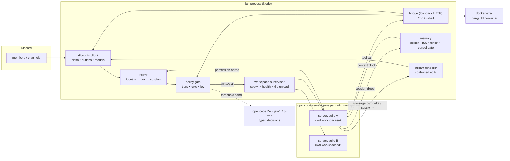
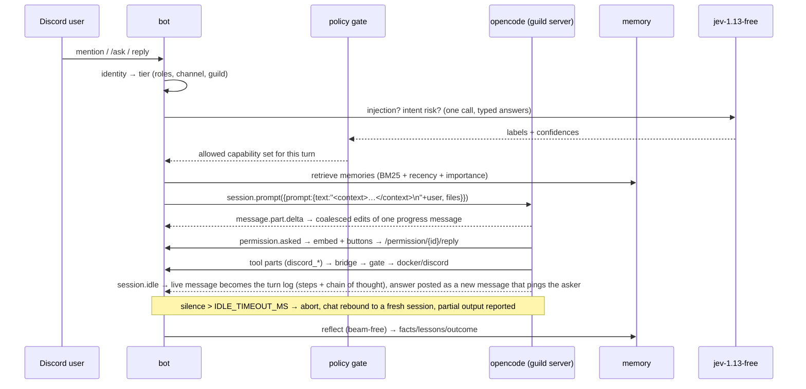
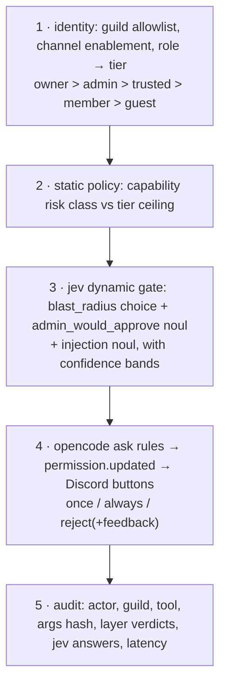
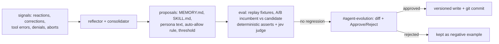

# open-discord-agent — design plan (v2)

Discord-native coding agent on the opencode SDK, with permissioned action in Discord, tool access to code
and to Discord itself, and self-evolving memory.

Scope: **multi-guild from the start, used on one server (you + friends)**. Shell exec: **docker by default,
host as an opt-in config flag**. Models: **only `crouton-alpha-free`, `beam-free`, `jev-1.13-free`** (OpenCode
Go/Zen free tier). Jev comes from OpenCode, not from a separate TypeSafe key.

Superseded in v2: the "one opencode server for all guilds" idea and the TypeSafe-SDK Jev integration. Both
were contradicted by measurement (see §0).

---

## 0. Verified facts (measured, not assumed)

### 0.1 Environment

| Fact                                          | Value                                                                                                                                                                                                                                                                                           | How verified                        |
| --------------------------------------------- | ----------------------------------------------------------------------------------------------------------------------------------------------------------------------------------------------------------------------------------------------------------------------------------------------- | ----------------------------------- |
| `opencode` on PATH                            | `v2.0.32`                                                                                                                                                                                                                                                                                       | `opencode --version`                |
| npm `opencode-ai` `latest`                    | **`1.19.5`** (2.x is not published as `latest`)                                                                                                                                                                                                                                                 | `npm view opencode-ai dist-tags`    |
| `@opencode-ai/sdk` `latest` / `dev`           | `1.19.5` / `0.0.0-dev-202610280534`                                                                                                                                                                                                                                                             | `npm view`                          |
| **2.0.32 has no matching SDK**                | both SDK builds request `/global/health`, `/session`, `/config`; 2.0.32 serves the API under **`/api/*`** behind HTTP basic auth and returns SPA HTML for the SDK paths → `Request is not supported by this version of OpenCode Server`                                                         | probes against live 2.0.32 server   |
| 1.19.5 pair works                             | `opencode-ai@1.19.5` server + `@opencode-ai/sdk@1.19.5`: `/global/health` → `{"healthy":true,"version":"1.19.5"}`, `/config/providers`, `/agent`, `/session`, `/event` all JSON                                                                                                                 | live probes                         |
| Windows binary                                | npm install pulls `opencode-windows-x64@1.19.5`; binary runs; `debug paths` honors `XDG_DATA_HOME`/`XDG_STATE_HOME`/`XDG_CACHE_HOME`                                                                                                                                                            | live                                |
| State collision                               | 1.19.5 against 2.0.32's data dir aborts: `Database is not empty and has no session table` → bot needs its own data dir                                                                                                                                                                          | observed failure                    |
| Model entitlement                             | `opencode` provider ships `options.apiKey:"public"`; free models work with **no** credentials                                                                                                                                                                                                   | `/config/providers`                 |
| Pinned catalog lacks crouton                  | 1.19.5 offers `beam-free`, `deepseek-v4.1-flash-free`, `flint-40b-free`, `glm-5.3-flash-free`, `mimo-v2.6-flash-free`, `nemotron-*` — **no `crouton-alpha-free`**; prompting it fails with `Model not found: opencode/crouton-alpha-free`                                                       | `/config/providers` + session.error |
| Fix: declare the model                        | a `provider.opencode.models["crouton-alpha-free"]` entry (`api.npm: "@ai-sdk/openai"`, `api.url: …/inference/openai/v1`) makes the catalog list it and prompts stream `CROUTON_OK`                                                                                                              | live trial                          |
| E2E prompt                                    | `session.prompt` `opencode/beam-free` → `"SPIKE_OK"`, `cost: 0`; `opencode/crouton-alpha-free` → real answer, `cost: 0`                                                                                                                                                                         | live runs                           |
| Streaming events                              | `event.subscribe()` → `message.part.delta {field:"text", delta}`, `message.part.updated {part}`, `session.status {status:{type:"busy"\|"idle"}}`, `session.diff {diff}`, `session.idle`                                                                                                         | live runs                           |
| Jev (OpenCode's)                              | **not a chat model**; `POST https://opencode.ai/inference/systemone/v1/systemone`, `model:"jev-1.13-free"`, `Authorization: Bearer <opencode console OAuth access token>`; answers `{choice,confidence,probabilities}` / `{noul}` / `{score,legend}`; `usage.cost:0`, `billing_source:"free"`   | live call, 200                      |
| Credentials                                   | `opencode auth export` → `integrationID:"opencode"`, `value.type:"oauth"`, `access` (`st_…`), `refresh` (`rt_…`), `expires` (ms)                                                                                                                                                                | `opencode auth export`              |
| **Config + tool discovery is per server cwd** | server started in `spike/` → `/config` empty, `/experimental/tool/ids` lacks the workspace tool, `?directory=<workspace>` changes nothing; server started **in** the workspace → `permission:{edit:"deny",bash:"ask"}` loaded and tool `spike` discovered                                       | three live probes                   |
| Custom tool context                           | tool executed and returned `dir=C:\…\.spike-ws`, `session=ses_…`, i.e. `ctx.directory` + `ctx.sessionID` are real → bridge can derive guild/session identity                                                                                                                                    | live tool call                      |
| Permission ask contract                       | event `permission.asked` → `{id, sessionID, permission:"bash", patterns:["echo hello-permissions"], metadata:{command}, always:["echo *"], tool:{messageID,callID}}`; reply `POST /permission/{requestID}/reply {reply:"once"}` → `200 true`; then `permission.replied`, tool completes (2.2 s) | live round-trip                     |
| **SDK event types lag the server**            | SDK 1.19.5 types declare `permission.updated`; the 1.19.5 binary emits `permission.asked` / `permission.replied` (confirmed by live capture _and_ by strings inside the binary)                                                                                                                 | live capture + binary grep          |
| Event catalogue (1.19.5, observed)            | `server.connected`, `session.updated`, `session.status`, `session.diff`, `session.idle`, `message.updated`, `message.part.updated`, `message.part.delta {field,delta}`, `permission.asked`, `permission.replied`                                                                                | live runs                           |
| Live bridge e2e                               | real gateway (`Kirby#6618`), model called `discord_channels_list` through the generated workspace tool → bridge → tier gate (`allow`) → discord.js, answer `total=5 Text Channels`; audit row written                                                                                           | `bun run e2e`                       |

Consequence of the config-discovery row: **one opencode server per guild workspace**. Config, custom tools, skills, and
permission rules are resolved once at server start from its cwd, and the `directory` query parameter does not
re-target them.

### 0.2 Pinned stack (decision)

| Component                 | Version                                                                                                                       | Why                                                                                                                                                                                                            |
| ------------------------- | ----------------------------------------------------------------------------------------------------------------------------- | -------------------------------------------------------------------------------------------------------------------------------------------------------------------------------------------------------------- |
| `opencode-ai`             | `1.19.5` (project dependency, not the global CLI)                                                                             | only published version with a matching SDK                                                                                                                                                                     |
| `@opencode-ai/sdk`        | `1.19.5`                                                                                                                      | documented client; `session.*`, `event.subscribe` verified. Approval reply is posted directly to `/permission/{requestID}/reply` because the SDK only wraps the legacy `/session/{id}/permissions/{pid}` route |
| `discordx` / `discord.js` | `11.13.3` / `14.28.1`                                                                                                         | current                                                                                                                                                                                                        |
| Runtime                   | **Bun `1.4.3`** (not Node) — `bun:sqlite` (FTS5), `Bun.spawn`, `Bun.serve` for the bridge; cross-platform Linux/Windows/macOS | installed                                                                                                                                                                                                      |
| SQLite                    | `bun:sqlite` (no native build step)                                                                                           | built in                                                                                                                                                                                                       |

Boot guard: call `/global/health`; refuse to start unless `version === "1.19.5"`. Bumping the pin means
re-running every check in §0.1 (the 2.0.x API move proves the surface is not stable across majors).

The global `opencode` v2.0.32 stays untouched and unused by the bot — it is only used once, by setup, to
export the console credential (§3.3).

---

## 1. Architecture



### 1.1 Tenancy: workspace dir + server per guild

```text
workspaces/<guildID>/            # server cwd; also the agent's sandbox
  opencode.json                  # permission rules, agent defs, model
  AGENTS.md                      # persona, tool rules, memory digest pointer
  MEMORY.md                      # durable facts digest, rewritten by consolidator
  .opencode/tools/discord.ts     # generated bridge tool (guildID baked in, shadows bash)
  .opencode/skills/<name>/SKILL.md
  repo/                          # code target
```

Supervisor: spawn `opencode serve --hostname 127.0.0.1 --port <free>` with cwd = workspace, isolated
`XDG_DATA_HOME` (bot-owned, shared across workspaces), `OPENCODE_SERVER_PASSWORD=<per-guild random>`; client
uses basic auth. Idle workspaces (no prompt, no open session) unload after 30 min; restart on demand; session
IDs persist in bot DB so a respawn resumes via `session.messages`. One live server per guild that is active;
your server = 1 process.

Rejected: single server + `directory` query (proven not to reload config/tools); one server per _channel_
(needless); MCP-hosted tools (no session/directory identity).

### 1.2 Tool bridge

`.opencode/tools/discord.ts` is generated per workspace and exports one tool per capability:

```ts
import { tool } from "@opencode-ai/plugin";
const GUILD = "123";             // baked in; matches the workspace dir
const RPC = "http://127.0.0.1:7071/rpc";
const TOKEN = "…";               // per-workspace secret, baked in

const call = async (name: string, args: unknown, ctx: any) => {
  const r = await fetch(RPC, {
    method: "POST",
    headers: { "x-bridge-token": TOKEN, "content-type": "application/json" },
    body: JSON.stringify({ guild: GUILD, name, args, sessionID: ctx.sessionID }),
  });
  return r.text();
};

export const channel_create = tool({ description: "…", args: {…}, async execute(a, c) { return call("channel_create", a, c); } });
// … one export per capability; tool ids become discord_channel_create, etc.
```

The bridge is the only place Discord mutations happen; it re-derives `(guild, channel, actor)` from the
session→channel binding, never from model args, and applies the policy gate per call. A tampered tool file can
only break itself, and `edit` on `.opencode/**` / `opencode.json` is `deny` in the workspace config.

`bash` shadowing: the same generated file exports a `bash` tool (name collision wins over the builtin) that
POSTs to `/shell`, which runs the command in the guild's container (`docker exec -w /work`) by default or on
the host when `shell.mode: "host"`. Shell output is capped and returned as the tool result.

---

## 2. Message → answer flow



---

## 3. Model policy

Roles, not model names: `MODEL_PRIMARY`, `MODEL_FAST`, `MODEL_JEV` in `.env`, each defaulting to the OpenCode
Go pair below. A `provider/model` id is validated by matching the longest **known provider id** (`models.ts`
→ `providers.ts`): the provider must have a credential or be declared, so a typo fails at `/model set` and in
`doctor` instead of at answer time, while any model the provider serves stays usable. `MODEL_ALLOWLIST`
restores the old hard pin for deployments that want it.

| Role                                                   | Model (default)                  | Notes                                                                                                  |
| ------------------------------------------------------ | -------------------------------- | ------------------------------------------------------------------------------------------------------ |
| Primary agent (chat, code, tool use)                   | `opencode-go/crouton-alpha-free` | 1M context; overridable per guild with `/model set`, which the runtime resolves per prompt             |
| Fast/secondary (title gen, summaries, vision-ish jobs) | `opencode-go/beam-free`          | used for reflection and consolidation to keep the big model free of bulk text                          |
| Typed decisions (safety, routing, eval judging)        | `jev-1.13-free`                  | Zen systemone endpoint; returns labels + probabilities, never text; called directly, so no provider id |

Providers (§3.4) are two kinds: catalogue ids the pinned server already knows (`openai`, `anthropic`,
`google`, `openrouter`, `deepseek`, `groq`, `mistral`, `xai`, `cerebras`, `togetherai`, `opencode-go`,
`opencode`) — a credential in `.env` is all they need — and `@ai-sdk/openai-compatible` entries declared in
`config/providers.json` for local runtimes and private gateways. Both are rendered into each workspace's
`opencode.json` with `{env:NAME}` credential references: the workspace is a git repo committed every turn, so a
literal secret there would be permanent. Verified against the pinned binary: a custom provider block is
accepted and its models enumerated (`opencode models`), and an unset `{env:…}` reference is tolerated.

`/model current|list|set|reset` is the in-Discord surface; the catalogue behind `list` comes from the guild's
own server (`GET /config/providers`), so it can never offer a model the server would reject. Switching a model
stops that guild's server so the next prompt re-provisions and reloads `opencode.json`.

### 3.3 Jev access

```ts
// src/policy/jev.ts
const ENDPOINT = 'https://opencode.ai/inference/systemone/v1/systemone';
const res = await fetch(ENDPOINT, {
  method: 'POST',
  headers: { authorization: `Bearer ${token}`, 'content-type': 'application/json' },
  body: JSON.stringify({ model: 'jev-1.13-free', state, questions }),
});
```

Token = the OpenCode console OAuth `access` token. Bootstrap: `opencode auth export` (once, at setup) →
`auth.json` in the bot's private dir; refresh on 401 with `refresh` (`rt_…`) and persist. Never logged, never
in memory rows. If refresh fails → gate degrades to "escalate to human" (never auto-allow).

No `@typesafe-ai/sdk` dependency: the endpoint is plain JSON, and the SDK assumes a TypeSafe-issued key.

---

## 4. Permission system — five layers, fail closed



- Deterministic rules first. Jev is consulted only where static policy cannot decide.
- Bands (calibrated from logged decisions, kept in `config/thresholds.json`): `admin_would_approve ≥ 0.90`
  **and** `blast_radius ∈ {read_only, reversible}` **and** `confidence ≥ 0.85` → auto-allow; `0.5–0.85` →
  human approval; `< 0.5` / `catastrophic` / error / timeout → deny.
- Jev returns no rationale ("it decides, it doesn't explain"), so Discord shows the label + confidence and the
  raw answers are stored in `policy_decisions` for later calibration.
- Shadow mode first: label 100% of calls, still ask; enforce after ≥95% agreement over ≥200 calls, reported in
  `#agent-evolution`.
- Approvals (verified contract): server emits `permission.asked` `{id, sessionID, permission, patterns[], metadata, always[], tool}`; bot posts an embed with `Once` / `Always` / `Reject` (modal) and replies `POST /permission/{id}/reply` `{reply:"once"|"always"|"reject"}`. `always[]` supplies the exact pattern the `Always` button will persist, so the embed can show it ("would save `echo *`") instead of guessing. Approver tier ≥ admin, not the requester. 5-min timeout rejects.
- Workspace config (per guild) supplies the opencode-side rules; bot-side is authoritative:

```jsonc
{
  "$schema": "https://opencode.ai/config.json",
  "model": "opencode/crouton-alpha-free",
  "provider": {
    "opencode": {
      "models": {
        // required: the pinned server's catalog does not list crouton (§0.1)
        "crouton-alpha-free": {
          "api": {
            "id": "crouton-alpha-free",
            "url": "https://opencode.ai/inference/openai/v1",
            "npm": "@ai-sdk/openai",
          },
        },
      },
    },
  },
  "permission": {
    "bash": { "*": "ask", "git status*": "allow", "git diff*": "allow", "ls*": "allow" },
    "edit": { "*": "ask", ".opencode/*": "deny", "opencode.json": "deny", "AGENTS.md": "deny" },
    "webfetch": "ask",
  },
}
```

(1.19.5 uses the `permission` / `bash` / `agent` names, not v2's `permissions` / `shell` / `agents` — confirmed
by `/config` on the pinned server. The v2 docs on the website describe the 2.x line.)

---

## 5. Memory & learning

SQLite (`better-sqlite3`, FTS5), one DB in the bot data dir, guild-scoped rows:

```sql
episodes(id, guild_id, session_id, started_at, ended_at, summary, outcome, tokens, cost_usd)
memory(id, guild_id, scope, kind, key, text, importance, confidence, source_episode, created_at,
       last_used_at, uses, superseded_by)          -- kind: fact|preference|lesson|pointer
memory_fts(memory_fts)
entities(id, guild_id, type, name, attrs_json)
relations(src_id, rel, dst_id, confidence)
feedback(id, guild_id, message_id, actor, signal, note)
tool_stats(guild_id, tool, ok, fail, avg_ms, denials, last_used)
policy_decisions(id, ts, guild_id, actor, tool, args_hash, layer, verdict, jev_json)
artifacts(kind, path, version, sha256, approved_by, created_at)
```

Write paths: `/remember` (explicit); reflector on `session.idle` (structured extraction with `beam-free`,
secrets-scan + dedupe + contradiction→`superseded_by`); outcome signals (reactions, aborts, denials, tool
errors, user corrections); nightly consolidator (merge, promote to `MEMORY.md`/skills, decay, prune).

Read path: `0.6*BM25 + 0.25*recency + 0.15*importance`, top-k under ~1.5k tokens, rendered as `<memory>`
prefix on the user turn; `MEMORY.md` (≤2k tokens) is loaded by opencode as project instructions. No embedding
service in v1 — deterministic and testable; vectors only if the eval harness shows recall gaps.

### 5.4 Evolution loop



Fixtures: ~30 recorded scenarios (prompt, expected tool calls, postconditions: file content, channel exists,
message sent). Score = deterministic pass rate + `jev-1.13-free` `choice{pass,partial,fail}`. Promotion only
on non-regression; rollback = git revert.

---

## 6. Discord UX

- Triggers: mention, reply-to-bot, `/ask` in enabled channels, DM if allowlisted. Auto-thread for long tasks.
- Commands: `/ask`, `/new`, `/abort`, `/model`, `/agent`, `/memory search|pin|forget|stats`, `/remember`,
  `/policy show|allow|deny`, `/approvals`, `/audit`, `/learn`, `/workspace`, `/status`.
- Streaming: one live message, coalesced edits ≥1.2 s; `message.part.delta` for text; tool parts appended as
  `🔧 discord_channel_create → ok`; final message chunked on code fences; artifacts uploaded as attachments.
- Guards: one in-flight prompt per channel (queue), per-guild daily token budget, `maxSteps`, `/abort` →
  `session.abort`, restart resumes by replaying `session.messages`.

---

## 7. Repo layout (follows the discord-bot-template conventions)

```text
src/
  main.ts                  entry: env check, instance lock, @discordx/importer, client.build(), deploy, login
  client.ts                discordx Client (intents/partials from utils/constants)
  commands/                slash commands + component interactables
  events/                  ready, mention prompts, interaction safety net
  guards/                  cooldown, guildOnly, ownerOnly, guildEnabled
  cli/                     bun run commands deploy|clear|list|auth|doctor|smoke|e2e
  services/
    config.ts              guilds.json, paths, model allowlist, shell defaults
    agent/                 binary, client, event adapter, supervisor, prompt runtime
    bridge/                capability registry + loopback RPC server
    policy/                tier ceilings, Jev client
    memory/                FTS5 store, injection, reflector
    workspace/             provisioning, generated tool file, docker/host shell
    discord/               approvals, stream renderer, service registry
    database/sqlite.ts     schema and stores
  utils/                   env, logger (pino), constants, instance lock
tests/                     policy, memory, chunking
config/                    guilds.json (runtime, gitignored) + example
deploy/                    systemd unit
.data/workspaces/<guild>/  runtime sandbox (gitignored)
```

Framework choices inherited from the template: decorator discovery via `@discordx/importer`, guard middleware,
pino logging (pretty in development, files in production), REST command deployment with a diff CLI, ESLint +
Prettier, and Bun scripts (`dev`, `start`, `build`, `typecheck`, `lint`, `format`, `commands`, `test`).

---

## 8. Phases

| #   | Phase                  | Exit test (observed)                                                                                                                                                                                                                       | Status                                                                                                                                                                                                                                                                                                                                                                                                                                                                                                                                                                |
| --- | ---------------------- | ------------------------------------------------------------------------------------------------------------------------------------------------------------------------------------------------------------------------------------------ | --------------------------------------------------------------------------------------------------------------------------------------------------------------------------------------------------------------------------------------------------------------------------------------------------------------------------------------------------------------------------------------------------------------------------------------------------------------------------------------------------------------------------------------------------------------------- |
| 0   | Spike                  | pinned pair boots; prompt via `beam-free` + `crouton-alpha-free`; streaming events; jev 200 with typed answers; workspace-rooted server loads `permission` config and discovers a custom tool; `permission.asked` → reply → tool completes | **done**                                                                                                                                                                                                                                                                                                                                                                                                                                                                                                                                                              |
| 1   | Skeleton bot           | `/ask` answers in a channel, live tool lines, `/abort` stops, restart resumes                                                                                                                                                              | implemented on the template layout: `src/commands/*` decorated slash commands with guards, `/ask` `/help` `/model` `/new` `/abort` `/status` `/audit` `/enable` `/ping` `/remember` `/memory`, event-driven mention handling, coalesced renderer, fence-safe chunking, per-chat queue; decorator load verified (13 commands, 4 events, 1 button), prompt/streaming verified by `bun run smoke`. Command publishing calls `MetadataStorage.build()` first — without it the payload ships without options and slash groups (`bun run commands list` reported the drift) |
| 2   | Bridge + static policy | agent creates a channel as admin, denied as member, denial audited                                                                                                                                                                         | implemented and **verified live** (`bun run e2e`): model → `discord_channels_list` → bridge → `allow`/`tier` → real channel data; 14 capabilities, token-authenticated loopback bridge, channel-derived identity, tier ceilings, audit + tool stats                                                                                                                                                                                                                                                                                                                   |
| 3   | Approvals              | real `permission.asked` rendered as buttons; `once`/`always`/`reject` all take effect; timeout rejects                                                                                                                                     | implemented and **verified** (`bun run smoke`): `permission.asked` → `POST /permission/{id}/reply` → tool completes; allow-once / always / reject cards, approver tier check, 3-minute timeout, session-end cancellation                                                                                                                                                                                                                                                                                                                                              |
| 4   | Jev gate               | shadow agreement report on real traffic; forced jev failure still denies                                                                                                                                                                   | client + shadow/enforce modes implemented and called on every non-read bridge decision; live answer observed (`destructive`, P≈0.02)                                                                                                                                                                                                                                                                                                                                                                                                                                  |
| 5   | Memory v1              | fact from Monday recalled Wednesday in a new session; secret-looking string rejected                                                                                                                                                       | implemented: FTS5 store with dedupe/supersede, `beam-free` reflector with credential scrubbing, `<memory>` retrieval injection, `MEMORY.md` digest, `/remember` + `/memory`; unit-tested (11 tests). Recall-across-days still needs a live multi-session run                                                                                                                                                                                                                                                                                                          |
| 6   | Evolution              | proposed `SKILL.md` patch eval'd, diff posted, approved, applied, revertible                                                                                                                                                               | not implemented yet                                                                                                                                                                                                                                                                                                                                                                                                                                                                                                                                                   |
| 7   | Ops                    | kill/restart mid-task recovers; backup restores; docker shell works per guild                                                                                                                                                              | partial: systemd unit + doctor + idle unload + self-healing supervisor; docker runner written but untested on this Windows box (no daemon)                                                                                                                                                                                                                                                                                                                                                                                                                            |

### 0.3 Remaining spike items (not architecture-critical)

1. ~~`permission.asked` round-trip~~ — **verified**: ask event → `/permission/{id}/reply {"reply":"once"}` → tool completes.
2. Shadowing `bash` with a custom tool named `bash` (documented behavior, unverified) — needed for the docker
   shell runner; fallback is a separate `shell` tool plus a config `deny` on `bash`.
3. `docker exec` latency per command; whether one warm container per guild beats per-command runs.

---

## 9. Risks and fallbacks

| Risk                                                                                             | Impact                              | Mitigation                                                                                                                                                                              |
| ------------------------------------------------------------------------------------------------ | ----------------------------------- | --------------------------------------------------------------------------------------------------------------------------------------------------------------------------------------- |
| CLI/SDK major drift (2.0.32 already moved to `/api`)                                             | total breakage                      | pin both at 1.19.5 in `package.json`; boot guard on `/global/health` version; never use the global CLI                                                                                  |
| Global `opencode` upgrade by you                                                                 | none to the bot, but confusion      | README states the bot has its own copy; `npm run doctor` reports both versions                                                                                                          |
| Config/tool discovery tied to server cwd                                                         | wrong config for a guild            | supervisor spawns per workspace; a boot self-test asserts the workspace config is loaded and the bridge tool id is present                                                              |
| SDK event types lag the server (`permission.updated` in types vs `permission.asked` on the wire) | approvals silently never fire       | all raw events pass through one adapter (`src/agent/events.ts`) that maps observed names, never SDK type names; boot self-test asserts an ask round-trip before the bot reports healthy |
| Free-tier model availability changes                                                             | prompts fail                        | allowlist in config with ordered fallback (`crouton-alpha-free` → `beam-free`), explicit error to Discord, never silent model swap outside the allowlist                                |
| Jev token expiry / refresh failure                                                               | no dynamic gate                     | refresh flow; degrade to human approval; jev answers logged for calibration                                                                                                             |
| Docker unavailable (Windows/WSL, no daemon)                                                      | shell cannot run                    | `shell.mode` flag; `.env` override to `host` with a warning banner in `/status`; deny-list still applies                                                                                |
| Prompt injection (Discord text, repo files)                                                      | hijacked actions                    | identity from channel binding; risk classes; jev injection question; immutable config; destructive ops human-approved                                                                   |
| Discord rate limits / 2000-char cap                                                              | dropped output                      | edit coalescing, fence-aware chunking, discord.js rest queue                                                                                                                            |
| Privileged intents missing (`GuildMembers`, `MessageContent`)                                    | empty member list / no message text | README setup step; `/status` reports intent errors                                                                                                                                      |
| `better-sqlite3` native build on Node 26                                                         | install failure                     | `node:sqlite` fallback behind the same store interface                                                                                                                                  |
| Agent self-modification                                                                          | silent drift                        | §5.4 gating, git versioning, non-regression evals                                                                                                                                       |

---

## 10. Decisions (resolved)

| Question           | Answer                                                                                                                        |
| ------------------ | ----------------------------------------------------------------------------------------------------------------------------- |
| Tenancy            | multi-guild architecture, one server today (§1.1)                                                                             |
| Shell blast radius | `docker` default, `host` optional per guild config                                                                            |
| Jev source         | OpenCode Zen systemone endpoint, `jev-1.13-free`, console OAuth token (§3.3)                                                  |
| Models             | allowlist of exactly `crouton-alpha-free`, `beam-free`, `jev-1.13-free`; primary = crouton, reflector = beam, decisions = jev |
| SDK pinning        | CLI + SDK both 1.19.5 as project deps, own data dir (§0.2)                                                                    |

Setup inputs still needed from you (not blocking design): Discord application client ID + bot token with
`GuildMembers` and `MessageContent` enabled, and the guild ID to seed `config/guilds.json`.
